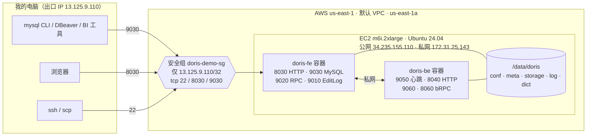
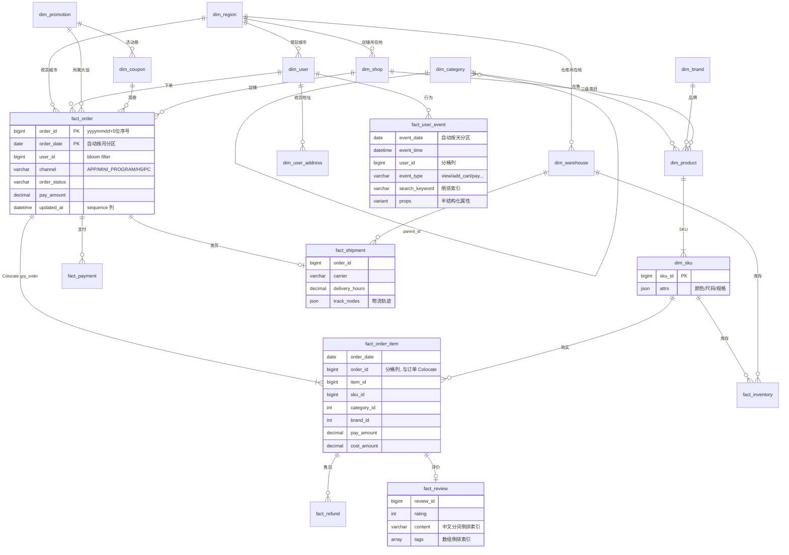

# Apache Doris 4.1.4 电商演示环境：部署 · 数据 · 故事线（复盘记录）

> 记录日期：2026-09-25（演示设定的"今天"= 2026 年中秋节）
> 目标：在 AWS us-east-1 用 Docker 部署当前最新版 Doris，导入结构复杂、十万级以上的电商数据，
> 通过一条"中秋节当天"的故事线完整展示 Doris 的实时写入、多维分析、用户洞察、全文检索、半结构化与性能加速能力。

---

## 0. 速览

| 项目 | 内容 |
|---|---|
| Doris 版本 | **4.1.4**（GitHub Release 2026-09-07，镜像 `apache/doris:fe-4.1.4` / `be-4.1.4`，实际版本串 `doris-4.1.4-rc04-ad35a140c7f`） |
| 部署形态 | 1 台 EC2（m6i.2xlarge，8 vCPU / 32 GiB，200 GB gp3，Ubuntu 24.04）上 Docker Compose 跑 1 FE + 1 BE，host 网络 |
| 公网入口 | `34.235.155.110`：MySQL 协议 **9030**、FE Web UI **8030**、SSH **22** |
| 访问控制 | 安全组 `doris-demo-sg` **只放行 `13.125.9.110/32`**，没有任何 `0.0.0.0/0` 规则，增删 IP 见 [§8.1](#81-安全组增删-ip) |
| 账号 | `root`（强密码）、`demo_ro`（只读 `ecom` 库）；密码在本地 `credentials.env`（chmod 600），本文不出现明文 |
| 数据 | 库 `ecom`：12 张维度表 + 8 张事实表 + 2 个视图；订单 **10 万**、明细 **19.2 万**、埋点 **102 万**、评价 8.2 万；共约 170 万行 |
| 导入耗时 | 删库重建 + 全量 Stream Load 约 **12 秒**（其中 102 万行 JSON 埋点 7.7 秒） |
| 故事线 | 7 幕、约 60 条 SQL，一键跑完 `bash scripts/07_run_story.sh`（约 2 分钟，0 报错） |
| 费用 | 运行中约 **$0.39/小时**（≈$9.4/天），停机后只剩 EBS 约 $16/月；清理命令见 [§9](#9-成本与清理) |

连接方式（本机）：

```bash
cd /home/ubuntu/AI-code/Doris-test
source credentials.env
mysql -h $DORIS_HOST -P 9030 -u demo_ro -p"$DORIS_RO_PASSWORD" ecom          # 只读账号
mysql -h $DORIS_HOST -P 9030 -u root    -p"$DORIS_ROOT_PASSWORD"              # 管理员
# 浏览器：http://34.235.155.110:8030  （用 root 登录，可看 QueryProfile / 系统状态）
ssh -i doris-demo-key.pem ubuntu@34.235.155.110
```

---

## 1. 需求回顾

1. 搜索当前 Doris 最新版本；
2. 在 AWS 美东 1（us-east-1）建一台实例，部署最新版 Doris（可用 Docker）；
3. 导入结构相对复杂的电商演示数据，能支撑复杂 SQL 和多维分析；
4. 给出完整步骤，数据量达到 **10 万级**（不要几百条的玩具数据）；
5. 可从公网访问，但**安全组不能开放 0.0.0.0**，且要方便自己修改白名单；
6. 补充：基于这套数据设计一条**便于演示的故事线**，充分展示 Doris 能力；最后整理成一份 md 用于记录、学习、复盘（即本文）。

确认过的默认选择：白名单 `13.125.9.110/32`；m6i.2xlarge + 200 GB gp3 + Ubuntu 24.04 + 默认 VPC；新建密钥对保存在本地；root 设强密码并另建只读账号 `demo_ro`。

---

## 2. 版本调研

```bash
# GitHub Releases：最新正式版
curl -s "https://api.github.com/repos/apache/doris/releases?per_page=5" \
  | jq -r '.[] | [.tag_name, .published_at, .prerelease] | @tsv'
# Docker Hub：确认镜像 tag 已发布（fe / be 分开）
curl -s "https://hub.docker.com/v2/repositories/apache/doris/tags?page_size=100&ordering=last_updated" \
  | jq -r '.results[] | [.name, .last_updated] | @tsv' | grep 4.1.4
```

结论（2026-09-25 查询）：

| 版本 | 发布日期 | 说明 |
|---|---|---|
| **4.1.4** | 2026-09-07 | 最新版；镜像 `fe-4.1.4` / `be-4.1.4` 于 2026-09-11 上架，支持 amd64/arm64 |
| 4.1.3 | — | 上一个 4.1.x |
| 4.0.8 | 2026-08-14 | 4.0.x 维护线 |

部署后校验：`SHOW FRONTENDS` / `SHOW BACKENDS` 中 Version 为 `doris-4.1.4-rc04-ad35a140c7f`。

---

## 3. 架构与资源清单



### 3.1 AWS 资源

| 资源 | ID / 值 |
|---|---|
| Region / AZ | us-east-1 / us-east-1a |
| VPC（默认） | `vpc-0b806cad7faf55718` |
| Subnet | `subnet-0a06e314475c5d116` |
| AMI | `ami-0045d7fc2ad003464`（Ubuntu 24.04，来自 SSM 参数 `/aws/service/canonical/ubuntu/server/24.04/stable/current/amd64/hvm/ebs-gp3/ami-id`） |
| 实例 | `i-0d5ea8c0157912a05`，m6i.2xlarge，IMDSv2 强制，Tag `Name=doris-demo`、`Project=doris-demo` |
| 公网 / 私网 IP | `34.235.155.110`（未绑定 EIP，停机再开机会变）/ `172.31.25.143` |
| EBS | `vol-0cd3dd07c1d7d8dc9`，200 GB gp3，3000 IOPS / 125 MB/s，随实例删除 |
| 密钥对 | `doris-demo-key`（ed25519），私钥 `doris-demo-key.pem`（chmod 400） |
| 安全组 | `sg-0a02e336df4299888`（`doris-demo-sg`） |

所有 ID 同时保存在 `resources.env`，脚本通过 `source resources.env` 使用。

### 3.2 安全组入站规则（当前）

| 端口 | 来源 | 描述 | 用途 |
|---|---|---|---|
| 22 | 13.125.9.110/32 | SSH | 登录主机、scp 文件 |
| 8030 | 13.125.9.110/32 | Doris-FE-HTTP | FE Web UI、REST API（Profile 等） |
| 9030 | 13.125.9.110/32 | Doris-MySQL | MySQL 协议查询（CLI / JDBC / BI） |

**未开放**：8040（BE HTTP）、9050/9060/8060（BE 内部）、9010/9020（FE 内部）。出站为默认全部放行。
实测：从白名单 IP 访问 8030 返回 HTTP 200，访问 8040 不通。

### 3.3 Doris 账号

| 账号 | 权限 | 说明 |
|---|---|---|
| `root` | 全部 | 强密码（生成方式见 §4.6）；**远程**无密码登录被拒（`ERROR 1045`） |
| `admin` | 全部 | 同样设置了强密码（与 root 相同） |
| `demo_ro@'%'` | `SELECT_PRIV ON internal.ecom.*` | 只读演示账号；实测建表被拒（需要 CREATE 权限）、DELETE 被拒（LOAD command denied） |

> 注意：Doris 默认 `skip_localhost_auth_check=true`（且不能在线修改），**在 EC2 本机**用 root 连 127.0.0.1 不需要密码——
> 本文所有 EC2 上的脚本都依赖这一点。安全性由"SSH 仅对白名单开放"保证。

---

## 4. 部署步骤（从零复现）

> 下列命令在本机 `/home/ubuntu/AI-code/Doris-test` 目录执行，标注【EC2】的在实例上执行。

### 4.1 创建 AWS 资源

```bash
export AWS_REGION=us-east-1
MYIP=13.125.9.110/32                       # 或 $(curl -s https://checkip.amazonaws.com)/32
VPC=$(aws ec2 describe-vpcs --filters Name=isDefault,Values=true --query 'Vpcs[0].VpcId' --output text)
SUBNET=$(aws ec2 describe-subnets --filters Name=vpc-id,Values=$VPC Name=default-for-az,Values=true \
          --query 'Subnets[0].SubnetId' --output text)
AMI=$(aws ssm get-parameter --name /aws/service/canonical/ubuntu/server/24.04/stable/current/amd64/hvm/ebs-gp3/ami-id \
          --query Parameter.Value --output text)

# 1) 密钥对（私钥只在创建时返回一次）
aws ec2 create-key-pair --key-name doris-demo-key --key-type ed25519 \
    --query KeyMaterial --output text > doris-demo-key.pem
chmod 400 doris-demo-key.pem

# 2) 安全组：只放行本机出口 IP 的 22 / 8030 / 9030
SG=$(aws ec2 create-security-group --group-name doris-demo-sg --description "Doris demo - whitelist only" \
      --vpc-id $VPC \
      --tag-specifications 'ResourceType=security-group,Tags=[{Key=Name,Value=doris-demo-sg},{Key=Project,Value=doris-demo}]' \
      --query GroupId --output text)
aws ec2 authorize-security-group-ingress --group-id $SG --ip-permissions \
  "IpProtocol=tcp,FromPort=22,ToPort=22,IpRanges=[{CidrIp=$MYIP,Description=SSH}]" \
  "IpProtocol=tcp,FromPort=8030,ToPort=8030,IpRanges=[{CidrIp=$MYIP,Description=Doris-FE-HTTP}]" \
  "IpProtocol=tcp,FromPort=9030,ToPort=9030,IpRanges=[{CidrIp=$MYIP,Description=Doris-MySQL}]"

# 3) 实例：m6i.2xlarge + 200GB gp3 + IMDSv2
aws ec2 run-instances --image-id $AMI --instance-type m6i.2xlarge --key-name doris-demo-key \
  --subnet-id $SUBNET --security-group-ids $SG --associate-public-ip-address \
  --block-device-mappings 'DeviceName=/dev/sda1,Ebs={VolumeSize=200,VolumeType=gp3,DeleteOnTermination=true}' \
  --metadata-options HttpTokens=required \
  --tag-specifications 'ResourceType=instance,Tags=[{Key=Name,Value=doris-demo},{Key=Project,Value=doris-demo}]' \
                       'ResourceType=volume,Tags=[{Key=Project,Value=doris-demo}]'
aws ec2 wait instance-running --instance-ids <InstanceId>
aws ec2 describe-instances --instance-ids <InstanceId> \
  --query 'Reservations[0].Instances[0].[PublicIpAddress,PrivateIpAddress]' --output text
# 把各 ID / IP 写入 resources.env
```

### 4.2 上传脚本与配置

```bash
source resources.env
scp -i doris-demo-key.pem scripts/*.sh scripts/gen_ecom_data.py sql/01_ddl.sql sql/02_views.sql ubuntu@$PUBLIC_IP:~/
ssh -i doris-demo-key.pem ubuntu@$PUBLIC_IP 'mkdir -p ~/deploy'
scp -i doris-demo-key.pem deploy/docker-compose.yml ubuntu@$PUBLIC_IP:~/deploy/
```

### 4.3 主机初始化【EC2】

`scripts/01_host_setup.sh`：安装 Docker CE（官方 apt 源）+ compose 插件、`mysql-client-core-8.0`、`jq`；
设置 `vm.max_map_count=2000000`、`vm.swappiness=0`、`swapoff -a`；用 systemd unit 开机关闭透明大页；nofile 655350。

```bash
bash ~/01_host_setup.sh
```

### 4.4 准备目录与默认配置【EC2】

```bash
sudo mkdir -p /data/doris/{fe/conf,fe/doris-meta,fe/log,be/conf,be/storage,be/log}
sudo docker pull apache/doris:fe-4.1.4 && sudo docker pull apache/doris:be-4.1.4
# 从镜像中取出默认 fe.conf / be.conf 放到宿主机，便于修改与持久化
sudo docker run --rm --entrypoint cat apache/doris:fe-4.1.4 /opt/apache-doris/fe/conf/fe.conf | sudo tee /data/doris/fe/conf/fe.conf >/dev/null
sudo docker run --rm --entrypoint cat apache/doris:be-4.1.4 /opt/apache-doris/be/conf/be.conf | sudo tee /data/doris/be/conf/be.conf >/dev/null
```

### 4.5 启动 FE / BE 并注册 BE【EC2】

`deploy/docker-compose.yml`（全文）：

```yaml
# Apache Doris 4.1.4 单机部署：1 FE + 1 BE，host 网络
# 不使用镜像自带 entrypoint（它用无密码 root 做健康检查，设置 root 密码后重启会失败），
# 直接以前台模式启动 FE/BE，配置、元数据、数据、日志全部挂载到宿主机 /data/doris。
services:
  fe:
    image: apache/doris:fe-4.1.4
    container_name: doris-fe
    network_mode: host
    restart: unless-stopped
    entrypoint: ["/opt/apache-doris/fe/bin/start_fe.sh", "--console"]
    volumes:
      - /data/doris/fe/conf/fe.conf:/opt/apache-doris/fe/conf/fe.conf
      - /data/doris/fe/doris-meta:/opt/apache-doris/fe/doris-meta
      - /data/doris/fe/log:/opt/apache-doris/fe/log
  be:
    image: apache/doris:be-4.1.4
    container_name: doris-be
    network_mode: host
    restart: unless-stopped
    entrypoint: ["/opt/apache-doris/be/bin/start_be.sh", "--console"]
    ulimits:
      nofile: { soft: 655350, hard: 655350 }
    volumes:
      - /data/doris/be/conf/be.conf:/opt/apache-doris/be/conf/be.conf
      - /data/doris/be/storage:/opt/apache-doris/be/storage
      - /data/doris/be/log:/opt/apache-doris/be/log
      # jieba 自定义词典（由 scripts/04_custom_dict.sh 生成）
      - /data/doris/be/dict/user.dict.utf8:/opt/apache-doris/be/dict/user.dict.utf8:ro
    depends_on: [fe]
```

`scripts/02_deploy_doris.sh` 做的事：

1. 通过 IMDSv2 取私网 IP，追加配置：
   - fe.conf：`priority_networks = 172.31.25.143/32`、`force_olap_table_replication_num = 1`（单 BE，所有表含异步物化视图强制 1 副本）
   - be.conf：`priority_networks = 172.31.25.143/32`、`storage_root_path = /opt/apache-doris/be/storage`
2. 若 jieba 词典文件还不存在，先从镜像拷一份默认词典（否则 docker 会在挂载点建出一个目录）；
3. `docker compose up -d`，等 FE 可连，`ALTER SYSTEM ADD BACKEND '172.31.25.143:9050'`，等到 `Alive: true`。

```bash
bash ~/02_deploy_doris.sh
```

### 4.6 设置密码与只读账号【EC2】

```bash
source ~/credentials.env      # 本机生成的 credentials.env 已 scp 到 EC2（chmod 600）
mysql -h127.0.0.1 -P9030 -uroot <<SQL
SET PASSWORD FOR 'root'  = PASSWORD('${DORIS_ROOT_PASSWORD}');
SET PASSWORD FOR 'admin' = PASSWORD('${DORIS_ROOT_PASSWORD}');
CREATE USER 'demo_ro'@'%' IDENTIFIED BY '${DORIS_RO_PASSWORD}';
GRANT SELECT_PRIV ON internal.ecom.* TO 'demo_ro'@'%';
SQL
```

密码生成方式（本机）：`Dr$(openssl rand -hex 8)#R`、`Ro$(openssl rand -hex 6)#D`，写入 `credentials.env`（键：`DORIS_HOST / DORIS_MYSQL_PORT / DORIS_HTTP_PORT / DORIS_ROOT_USER / DORIS_ROOT_PASSWORD / DORIS_RO_USER / DORIS_RO_PASSWORD`）。

### 4.7 中文分词自定义词典【EC2】

评价全文检索用 jieba（`parser=chinese`）。默认词典会把「等了5天才到」切成「天才」，「发烫」「充不进电」不成词。
`scripts/04_custom_dict.sh`：从镜像取默认 `user.dict.utf8`，追加业务词，挂载进 BE 并重启：

```text
发烫 50000 v
才到 50000 v
充不进电 20000 v
```

效果：`TOKENIZE('等了5天才到，充电时发烫严重', ...)` → `等 / 天 / 才到 / 充电 / 时 / 发烫 / 严重`。
**词典只影响之后新建的倒排索引**，所以要在导入数据之前执行（或导入后重建表/索引）。

```bash
bash ~/04_custom_dict.sh
```

### 4.8 生成数据、建表、导入【EC2】

```bash
python3 ~/gen_ecom_data.py --out ~/data        # 纯标准库，固定随机种子 20260925，结果可复现（约 511 MB）
bash ~/05_rebuild_db.sh                        # DROP DATABASE ecom FORCE -> 01_ddl.sql -> 02_views.sql -> 03_load_data.sh
```

`scripts/03_load_data.sh` 用 Stream Load（curl → FE 8030，FE 307 重定向到 BE 8040，均在本机完成）：

```bash
curl --location-trusted -u root:$DORIS_ROOT_PASSWORD \
  -H "label:<唯一标签>" -H "max_filter_ratio:0" -H "strict_mode:true" \
  -H "column_separator:\t" -H "columns:<来自 _columns.json 的列顺序>" \
  -T fact_order.tsv http://127.0.0.1:8030/api/ecom/fact_order/_stream_load
# 埋点 JSON Lines：-H "format:json" -H "read_json_by_line:true"，嵌套的 props 对象直接写入 VARIANT 列
```

实测导入（全部 `Success`、`filtered=0`）：19 个 TSV 表 + 102 万行 JSONL 合计约 12 秒。

### 4.9 验证

```bash
# 本机：远程账号 / 权限测试
mysql -h $PUBLIC_IP -P9030 -uroot -e "select 1"                              # ERROR 1045 Access denied（预期）
mysql -h $PUBLIC_IP -P9030 -udemo_ro -p"$DORIS_RO_PASSWORD" -e "select count(*) from ecom.fact_order"   # 100240
mysql -h $PUBLIC_IP -P9030 -udemo_ro -p"$DORIS_RO_PASSWORD" -e "create table ecom.t(a int) distributed by hash(a) buckets 1 properties('replication_num'='1')"  # 拒绝
curl -s -o /dev/null -w '%{http_code}\n' http://$PUBLIC_IP:8030/        # 200
curl -s -m 5 -o /dev/null -w '%{http_code}\n' http://$PUBLIC_IP:8040/   # 000（未开放，预期）

# 一键跑完故事线（先复位重建库）
bash scripts/07_run_story.sh          # 结果写入 results/，最后打印每个文件的 ERROR 行数（全部为 0）
# 点查压测【EC2】
bash ~/06_point_query_bench.sh 20000 16
```

主机状态（部署完成后）：内存 30 GB（已用约 9 GB），磁盘 193 GB（已用 15 GB），BE 数据目录约 180 MB（列存压缩后），两个容器 `Up`。

---

## 5. 数据模型

### 5.1 表清单与行数

| 表 | 模型 | 行数 | 说明 |
|---|---|---:|---|
| dim_date | UNIQUE | 730 | 2025-01-01 ~ 2026-12-31；节假日、大促、峰值日 |
| dim_region | UNIQUE | 73 | 城市 → 省 → 7 大区，城市等级，是否偏远 |
| dim_warehouse | UNIQUE | 12 | 中心仓 / 前置仓 / 保税仓 |
| dim_category | UNIQUE | 142 | **三级类目树（邻接表 parent_id）**，视图 `v_category` 展开 |
| dim_brand | UNIQUE | 150 | 国际 / 国货 / 新锐 |
| dim_shop | UNIQUE | 400 | 自营 / 旗舰店 / 专营店 / 普通店 |
| dim_product | UNIQUE | 6,045 | SPU，`tags ARRAY<STRING>` |
| dim_sku | UNIQUE | 14,389 | `attrs JSON`（颜色 / 尺码 / 规格 / 版本） |
| dim_user | UNIQUE | 60,000 | 会员等级、Plus、`user_tags ARRAY<STRING>` |
| dim_user_address | UNIQUE | 87,255 | 收货地址 |
| dim_promotion | UNIQUE | 12 | 年货节 / 女神节 / 618 / 99 划算节 / 双 11 / 双 12 / 中秋；`rules JSON` |
| dim_coupon | UNIQUE | 265 | 满减 / 无门槛 / 折扣券 |
| **fact_order** | UNIQUE (MoW) | **100,240** | 10 万历史 + 240 单中秋实时订单 |
| **fact_order_item** | DUPLICATE | **192,102** | 订单明细（冗余用户 / 店铺 / 类目 / 品牌） |
| fact_payment | DUPLICATE | 100,650 | 支付流水（含失败重试） |
| fact_shipment | UNIQUE | 93,818 | 物流运单，`track_nodes JSON` 轨迹 |
| fact_refund | UNIQUE | 13,182 | 售后退款 |
| fact_review | DUPLICATE | 81,520 | 商品评价，**中文倒排索引** |
| fact_inventory | UNIQUE | 19,848 | 库存快照（SKU × 仓库） |
| **fact_user_event** | DUPLICATE | **1,020,396** | 用户行为埋点（2026-05-14 ~ 09-25），`props VARIANT` |
| v_category / v_paid_order | 视图 | — | 类目三级展开；有效订单（PAID/SHIPPED/DELIVERED/COMPLETED/REFUNDED） |

时间范围：订单 2025-01-01 ~ 2026-09-24（历史）+ 2026-09-25 上午（实时演示）；埋点约 4.5 个月。
第 7 幕还会创建：异步物化视图 `mv_sales_daily`（6,176 行）、同步物化视图 `mv_item_brand_daily`、聚合模型表 `agg_daily_traffic`（4,927 行）。

### 5.2 ER 图



### 5.3 表设计要点（也是演示话术）

| 设计 | 用在哪 | 为什么 |
|---|---|---|
| **AUTO PARTITION**（按月 / 按天） | 所有事实表；埋点按天（135 个分区） | 不用预建分区，数据写到哪个月自动建哪个分区；查询按日期裁剪 |
| **HASH 分桶** | 订单 / 明细按 `order_id` 4 桶 | 主键等值查询只扫 1 个 tablet |
| **Colocate Group** `grp_order` | fact_order + fact_order_item | 同分桶列、同桶数 → Join 在本地完成，无网络 Shuffle |
| **Unique Key Merge-on-Write** | fact_order 等 | 支持 upsert / UPDATE / 部分列更新，读时无需合并，查询性能接近明细模型 |
| **Sequence 列** `updated_at` | fact_order | 乱序到达的旧状态消息不会覆盖新状态 |
| **行存** `store_row_column` | fact_order | 主键点查走 Short-Circuit，毫秒级 |
| **Bloom Filter** | fact_order.user_id | 非前缀列等值过滤加速 |
| **倒排索引**（中文分词、数组、数值） | fact_review.content / tags / rating、埋点 search_keyword | 全文检索 MATCH_ANY / MATCH_PHRASE，替代 LIKE |
| **VARIANT** | fact_user_event.props | 不同事件字段不同，写入即自动推断子列类型并列存 |
| **JSON / ARRAY** | sku.attrs、shipment.track_nodes、promotion.rules、user_tags | 半结构化属性直接查询 |
| 维表 UNIQUE + 1 桶 | 维度表 | 小表单桶，Join 时广播 |

### 5.4 数据里刻意埋入的 10 个业务规律（故事线的"伏笔"）

由 `scripts/gen_ecom_data.py` 生成（只依赖 Python 标准库，固定种子，可复现）：

1. **大促峰值**：年货节 / 女神节 / 618 / 99 划算节 / 双 11 / 双 12，峰值日 0 点抢购；
2. **同比增长**：2026 年较 2025 同期增长约 25%~30%，小程序占比持续提升；
3. **问题店铺**：「深圳极速数码配件专营店」2026-07 起低价冲量，质量问题导致退款、差评激增；
4. **物流瓶颈**：极兔速递发往西北明显偏慢，2026 年 618 期间尤甚，引发"物流慢"差评；
5. **A/B 实验**：2026-08-01 起新版详情页（B 组，user_id 为奇数）加购率更高；
6. **季节性**：羽绒服冬季、防晒/空调/风扇夏季、中秋前月饼礼盒暴涨；
7. **直播带货**：直播间流量占比逐月提升，垂类主播只带自家品类；
8. **需求缺口**：用户搜「AI眼镜」「三折叠手机」等平台没有的品类，零结果搜索逐月上升；
9. **尺码问题**：服装鞋靴的极端尺码（S / XXL / 36 / 44）退款率高，多为「尺码不合适」；
10. **埋点质量**：H5 支付埋点约 5% 丢失；APP 8.6.0 鸿蒙端 pay 事件金额单位误报为"分"。

---

## 6. 演示故事线："中秋节的一天"

> 设定：今天是 **2026-09-25 中秋节，时间 12:00**。你是电商平台的数据负责人，
> 上午先盯实时大屏，下午做经营复盘、用户洞察、问题排查，最后展示这些分析为什么能这么快。

| 幕 | 主题 | 业务问题 | 展示的 Doris 能力 | 时长 |
|---|---|---|---|---|
| 1 | 实时大屏 | 中秋上午卖得怎么样？订单状态实时回流 | Stream Load 秒级可见、部分列更新、Sequence 防乱序、UPDATE、行存点查 | 10 min |
| 2 | 经营大盘 | 今年比去年好在哪？哪个渠道在涨？ | 同比环比（LAG）、ROLLUP / CUBE / GROUPING SETS、非等值 JOIN | 8 min |
| 3 | 大促复盘 | 618 / 双 11 / 中秋卖了什么？ | 多表 JOIN、CTE、ROW_NUMBER / RANK、移动平均、行转列 | 8 min |
| 4 | 用户洞察 | 转化漏斗、A/B 效果、留存、谁是核心用户 | window_funnel、retention、RFM、Bitmap 交并差、ARRAY 标签圈人 | 10 min |
| 5 | 问题排查 | 哪家店出了问题？物流卡在哪？会不会断货？ | 窗口基线异常检测、中文分词 TOKENIZE、倒排全文检索、PERCENTILE、JSON 轨迹 | 10 min |
| 6 | 半结构化 | 埋点字段五花八门，能直接分析吗？ | VARIANT 自动子列、JSON 函数、埋点与交易对账 | 8 min |
| 7 | 性能加速 | 为什么这么快？数据再大怎么办？ | 分区分桶裁剪、Colocate Join、异步 MV 透明改写 + 分区增量刷新、同步 MV、聚合模型 BITMAP/HLL、Profile、点查压测 | 12 min |

### 6.0 演示操作顺序

```bash
cd /home/ubuntu/AI-code/Doris-test && source resources.env
SSH="ssh -i doris-demo-key.pem ubuntu@$PUBLIC_IP"

$SSH 'bash ~/05_rebuild_db.sh'                         # 0) 复位：删库重建 + 导入历史数据（约 12 秒）
#    客户端执行 ch1_1 的 1.0 → 今天 0 单
$SSH 'LOAD_REALTIME=1 bash ~/03_load_data.sh ~/data'   # 1) Stream Load 中秋上午 240 单 + 464 行明细
#    客户端执行 sql/story/ch1_1_realtime_dashboard.sql（1.1 ~ 1.5）
$SSH 'LOAD_REALTIME=2 bash ~/03_load_data.sh ~/data'   # 2) 部分列更新：137 单回流为 SHIPPED
#    客户端执行 sql/story/ch1_2_realtime_update.sql（1.6 ~ 1.11）
#    依次执行 ch2_overview → ch3_deep_dive → ch4_user_insight → ch5_diagnosis → ch6_semi_structured → ch7_performance

# 或者一键跑完并把结果存到 results/：
bash scripts/07_run_story.sh
# 单独跑某个文件（输出表格与耗时）：
bash scripts/run_sql.sh sql/story/ch5_diagnosis.sql
```

> 现场演示建议用 DBeaver / mysql CLI 连 `demo_ro` 执行第 2 ~ 6 幕（只读即可）；第 1 幕的写入和第 7 幕的建 MV / UPDATE 需要 root。
> **复位只能用 `05_rebuild_db.sh` 删库重建**，不能用 DELETE 删掉今天的数据再重导（原因见 [§7 踩坑 #18](#7-踩坑与解决)）。

---

### 第 1 幕 实时大屏（`ch1_1_realtime_dashboard.sql` + `ch1_2_realtime_update.sql`）

**场景**：12:00，老板问"中秋上午卖得怎么样？"。先展示今天还没数据（1.0 = 0 单），然后现场 Stream Load。

```text
fact_order         Success  loaded=240       filtered=0        38ms
fact_order_item    Success  loaded=464       filtered=0        37ms
```

**1.1 实时战报**（今天 0~12 点 vs 上周同日 vs 去年中秋同时段）

| day_label | paid_orders | buyers | gmv_wan | aov | new_buyer_pct |
|---|---:|---:|---:|---:|---:|
| 今天(中秋) | 225 | 224 | 22.0 | 977.6 | 21.3 |
| 上周同日 | 44 | 44 | 5.7 | 1297.1 | 27.3 |
| 去年中秋(2025-10-06) | 44 | 43 | 4.2 | 959.7 | 20.5 |

**1.2 分时累计曲线**（窗口函数 `SUM() OVER (ORDER BY hr)` + `REPEAT('#', …)` 画条形图）：今天 0 点就有 1.1 万（零点抢购），10~11 点冲到每小时 4.8 万，12 点累计 22.0 万；去年同期累计只有 4.2 万。

**1.3 / 1.4 中秋礼品类目**（今天上午 vs 去年中秋上午 vs 9 月前两周日均）

| cat3_name | today_qty | last_year_qty | normal_daily_qty |
|---|---:|---:|---:|
| 月饼礼盒 | 77 | 25 | 12.8 |
| 水果 | 50 | 4 | 7.8 |
| 海鲜水产 | 40 | 1 | 5.1 |
| 茶叶 | 31 | 0 | 6.1 |
| 葡萄酒 | 26 | 4 | 2.3 |
| 白酒 | 12 | 0 | 4.6 |

**1.5** 状态分布：PAID 225 / CANCELLED 11 / PENDING_PAYMENT 4。

**订单状态回流（部分列更新）**：仓库系统推来 137 条"已发货"消息，文件只有 5 列：

```bash
# 03_load_data.sh LOAD_REALTIME=2 实际执行的 Stream Load
curl --location-trusted -u root:*** -H "partial_columns:true" -H "column_separator:\t" \
  -H "columns:order_id,order_date,order_status,ship_time,updated_at" \
  -T realtime/rt_order_status_update.tsv http://127.0.0.1:8030/api/ecom/fact_order/_stream_load
```

| 步骤 | SQL 要点 | 结果 |
|---|---|---|
| 1.6 回流后 | 状态分布 | SHIPPED 137 / PAID 88 / CANCELLED 11 / PENDING 4 |
| 1.7 其它列不变 | 查 2026092500002 | SHIPPED，user 100722、pay_amount 742.70 原样保留，ship_time 03:41:18 |
| 1.8 乱序旧消息 | `SET enable_unique_key_partial_update=true; INSERT ... ('PAID', updated_at='01:00:00')` | **被忽略**，仍是 SHIPPED（Sequence 列判定为旧版本） |
| 1.9 正常新消息 | `INSERT ... ('DELIVERED', sign_time, updated_at='12:30:00')` | 变为 DELIVERED，pay_amount 仍是 742.70 |
| 1.10 标准 UPDATE | 11:30 前下单仍未支付 → CANCELLED（`updated_at` 设为 12:00） | 1 行更新；"支付超时自动取消"共 6 单，剩 3 单待支付 |
| 1.11 点查 | `EXPLAIN SELECT * ... WHERE order_id=? AND order_date=?` | 执行计划出现 **SHORT-CIRCUIT**，`partitions=1/21` |

**话术**：
- 数据导入到可查询是毫秒级，不需要 T+1；同一张表既能实时写，又能直接做分析。
- 订单状态这类 CDC 场景：部分列更新只传变更列；Sequence 列天然解决消息乱序；也支持标准 `UPDATE`。
- 同一张订单表既能跑大宽表聚合，也能扛主键点查（行存 + Short-Circuit，见第 7 幕压测：单会话 3.56 ms/条，16 并发约 1,510 QPS）。

---

### 第 2 幕 经营大盘（`ch2_overview.sql`）

| 小节 | 能力 | 关键结论 |
|---|---|---|
| 2.1 年度总览 | 条件聚合 | 2026（1/1~9/24）42,770 单、20,187 买家、GMV **6544.2 万**，对比 2025 同期 33,116 单、5184.4 万（**+26.2%**）；折扣率 5.55% → 6.34%，退款占比 1.19% → 1.01% |
| 2.2 月度趋势 | `LAG()` 环比 / 同比 | 2026-06 GMV 1365.8 万（环比 +69.9%，同比 +34.1%）；2026-01 同比 +53.3%；2026-09 只统计到 24 日，同比 −0.4% 基本持平 |
| 2.3 ROLLUP | 大区 → 城市等级逐级小计 | 华东 2301.1 万居首；全国合计 42,770 单 / 6544.2 万 |
| 2.4 CUBE | 渠道 × 终端全组合 + `GROUPING_ID` | APP 2886.5 万、小程序 2112.5 万、PC 938.8 万、H5 606.4 万；鸿蒙终端 1066.3 万 |
| 2.5 渠道变迁 | 季度透视 | 小程序占比 26.0%（2025Q1）→ **33.1%**（2026Q3）；PC 20.3% → 13.5% |
| 2.6 GROUPING SETS | 一条 SQL 出三张报表 | 日常 3981.8 万 vs 大促 2560.8 万；手机数码 1452.3 万第一 |
| 2.7 大促复盘 | 非等值 JOIN（日期 BETWEEN 活动起止）+ JSON 取规则 | 2026 年 618：7,912 单、1391.4 万、日均拉升 **3.15 倍**；2025 双 11 拉升 2.56 倍、峰值日贡献 29.5%；2026 中秋团圆季 222.9 万、拉升 1.10 倍 |

示例（2.3 ROLLUP，注意 GROUPING() 不能直接写进 ORDER BY，先在 CTE 中算成列）：

```sql
WITH t AS (
    SELECT GROUPING(r.area) AS g_area, GROUPING(r.city_tier) AS g_tier, r.area, r.city_tier,
           COUNT(*) AS orders, COUNT(DISTINCT o.user_id) AS buyers,
           ROUND(SUM(o.pay_amount) / 10000, 1) AS gmv_wan, ROUND(AVG(o.pay_amount), 1) AS aov
    FROM v_paid_order o JOIN dim_region r ON o.region_id = r.region_id
    WHERE o.order_date BETWEEN '2026-01-01' AND '2026-09-24'
    GROUP BY ROLLUP(r.area, r.city_tier)
), t2 AS (
    SELECT *, MAX(IF(g_tier = 1, gmv_wan, NULL)) OVER (PARTITION BY area) AS area_gmv FROM t
)
SELECT IF(g_area = 1, '== 全国合计 ==', area) AS area,
       IF(g_tier = 1, IF(g_area = 1, '', '-- 小计'), city_tier) AS city_tier, orders, buyers, gmv_wan, aov
FROM t2 ORDER BY g_area, area_gmv DESC, g_tier DESC, gmv_wan DESC;
```

**话术**：标准 SQL 全兼容（MySQL 协议），BI 常见的多维汇总一条 SQL 搞定；10 万订单 × 19 万明细的多表聚合都在几十毫秒内返回。

---

### 第 3 幕 大促深度复盘（`ch3_deep_dive.sql`）

| 小节 | 能力 | 关键结论 |
|---|---|---|
| 3.1 618 各类目 TOP3 | `ROW_NUMBER() OVER (PARTITION BY 类目)` + 类目内占比 | 家电第一是「川青 空调 Neo20」43.08 万（占类目 10.1%）；手机数码第一「尚优 微单相机 Lite17」32.36 万 |
| 3.2 类目同比 + 排名变化 | `RANK()` + 条件聚合 | 所有一级类目同比 +19%~34%，排名不变；家电 +34.2%、食品 +32.4% 增速最快 |
| 3.3 季节性 | 行转列透视（12 个月） | 月饼礼盒 9 月 719 件 / 10 月 552 件，其它月份约 10 件；羽绒服 11 月峰值；电风扇 6 月 454 件 |
| 3.4 中秋前月饼 | 按"距中秋天数"对齐两年 + 7 日移动平均 | 节前 1 天：2026 年 143 件（MA7 112.9）vs 2025 年 81 件（MA7 89.9） |
| 3.5 双 11 分时 | 聚合结果上再套窗口算累计占比 | 0 点 189 单，占全天 GMV 26.6%；20 点 125 单；到 20 点累计 82.3% |
| 3.6 毛利与退款 | 6 表 JOIN + LEFT JOIN 退款 | 新锐品牌 × 专营店毛利率最高 26.4%；自营 13%~17% 最低 |
| 3.7 新老客 | 按月首单占比 | 新客占比 23.8% → 20.2%，拉新压力显现 |

示例（3.4：两个年份按"距节日天数"对齐 + 移动平均）：

```sql
WITH d AS (
    SELECT i.order_date,
           IF(i.order_date <= '2025-10-06', DATE '2025-10-06', DATE '2026-09-25') AS festival,
           SUM(i.quantity) AS qty
    FROM fact_order_item i JOIN v_category c ON i.category_id = c.category_id
    WHERE c.cat3_name = '月饼礼盒'
      AND (i.order_date BETWEEN '2025-08-20' AND '2025-10-06' OR i.order_date BETWEEN '2026-08-10' AND '2026-09-24')
    GROUP BY i.order_date
), ma AS (
    SELECT YEAR(festival) AS yr, DATEDIFF(festival, order_date) AS days_before, qty,
           AVG(qty) OVER (PARTITION BY festival ORDER BY order_date ROWS BETWEEN 6 PRECEDING AND CURRENT ROW) AS ma7
    FROM d
)
SELECT days_before,
       MAX(IF(yr = 2025, qty, NULL)) AS qty_2025, ROUND(MAX(IF(yr = 2025, ma7, NULL)), 1) AS ma7_2025,
       MAX(IF(yr = 2026, qty, NULL)) AS qty_2026, ROUND(MAX(IF(yr = 2026, ma7, NULL)), 1) AS ma7_2026
FROM ma WHERE days_before IN (30, 25, 20, 15, 10, 7, 5, 3, 2, 1)
GROUP BY days_before ORDER BY days_before DESC;
```

**话术**：复杂分析 SQL（CTE、多层窗口、条件透视、多表 JOIN）不需要改写，Pipeline 执行引擎 + 向量化让它们在交互式时间内返回。

---

### 第 4 幕 用户洞察（`ch4_user_insight.sql`）

**4.1 转化漏斗**（`window_funnel`，1 小时窗口，9 月）

| channel | view | cart | checkout | order | pay | view→cart % | view→pay % |
|---|---:|---:|---:|---:|---:|---:|---:|
| APP | 8,166 | 4,025 | 2,589 | 1,860 | 1,744 | 49.3 | 21.4 |
| MINI_PROGRAM | 6,237 | 2,891 | 1,877 | 1,431 | 1,354 | 46.4 | 21.7 |
| PC | 2,501 | 1,053 | 719 | 580 | 545 | 42.1 | 21.8 |
| H5 | 1,769 | 616 | 447 | 375 | 316 | **34.8** | **17.9** |

```sql
SELECT user_id, channel,
       window_funnel(3600, 'default', event_time,
                     event_type = 'view', event_type = 'add_cart', event_type = 'checkout',
                     event_type = 'create_order', event_type = 'pay') AS lvl
FROM fact_user_event WHERE event_date BETWEEN '2026-09-01' AND '2026-09-24'
GROUP BY user_id, channel;
```

**4.2 A/B 实验**（分组在 VARIANT `props['ab_group']` 里）：加购率 A 33.67% vs B **38.13%**，提升 13.2%，z = 11.09（显著）；支付率 A 15.16% vs B 15.01%（无差异）——新详情页只提升了加购，没带来支付。

**4.3 新客留存**（`retention` 函数）：APP 次日 31.8% / 7 日 13.4% / 30 日 5.1%；H5 次日只有 12.6%。

**4.4 RFM 分层**：重要价值客户（111）占用户 16%，贡献 GMV **50.9%**。
**4.5 帕累托**：消费前 10% 的用户贡献 48.0% GMV，前 30% 贡献 79.9%。

**4.6 Bitmap 人群运算**（2025 双 11 买家 vs 2026 618 买家）：

| 双11买家 | 618买家 | 两次都买 | 流失（只买双11） | 618 新增 | 复购率 |
|---:|---:|---:|---:|---:|---:|
| 5,888 | 6,253 | 1,586 | 4,302 | 4,667 | 26.9% |

```sql
SELECT BITMAP_COUNT(BITMAP_AND(d11_2025, d618_2026))     AS both_bought,
       BITMAP_COUNT(BITMAP_AND_NOT(d11_2025, d618_2026)) AS d11_only_lost
FROM (SELECT BITMAP_UNION(IF(promo_id = 6,  TO_BITMAP(user_id), BITMAP_EMPTY())) AS d11_2025,
             BITMAP_UNION(IF(promo_id = 10, TO_BITMAP(user_id), BITMAP_EMPTY())) AS d618_2026
      FROM v_paid_order WHERE promo_id IN (6, 10)) s;
```

**4.7 intersect_count**：连续参加 2025-618 + 双 11 的 1,413 人，再加 2026-618 的 581 人，再加 2026 99 划算节的 70 人（"大促铁粉"）。
**4.8 / 4.9 ARRAY 标签**：`LATERAL VIEW explode(user_tags)` 统计各标签人数（沉睡用户 11,964 人最多）；
`array_contains(user_tags,'美妆控') AND array_contains(user_tags,'大促型') AND NOT array_contains(user_tags,'沉睡用户')` 圈出 **290 人**（其中 Plus 会员 42 人）作为中秋美妆礼盒 push 人群。

**话术**：漏斗、留存、精确去重人群交并差都是内置函数，不需要把数据导出到别的系统；Bitmap 精确去重是 Doris 的招牌能力。

---

### 第 5 幕 问题排查（`ch5_diagnosis.sql`）

一条完整的排查链路：**异常检测 → 差评分词找原因 → 全文检索定位店铺 → 评分走势确认 → 物流瓶颈 → 库存风险**。

**5.1 退款率异常检测**（店铺月度退款率 vs 自身过去 6 个月基线，`AVG() OVER (ROWS BETWEEN 6 PRECEDING AND 1 PRECEDING)`）

| shop_name | ym | items | refunds | 质量问题 | 退款率% | 基线% |
|---|---|---:|---:|---:|---:|---:|
| 深圳极速数码配件专营店 | 2026-07 | 184 | 32 | 29 | **17.4** | 0.8 |
| 深圳极速数码配件专营店 | 2026-08 | 231 | 51 | 49 | **22.1** | 3.7 |

**5.2 差评里突然冒出来的词**（1~2 星评价 `TOKENIZE` 分词 + `LATERAL VIEW explode_json_array_string`，比较 7 月前后日均词频）

| word | 上半年 | 7/1 起 | 日均提升倍数 |
|---|---:|---:|---:|
| 发烫 | 0 | 52 | 109.4 |
| 充不进电 | 0 | 39 | 82.1 |
| 两天 | 0 | 37 | 77.9 |
| 充电 | 7 | 32 | 8.4 |

```sql
SELECT IF(review_date >= '2026-07-01', 1, 0) AS is_after, word
FROM fact_review
LATERAL VIEW explode_json_array_string(
    json_extract(TOKENIZE(content, '"parser"="chinese","parser_mode"="coarse_grained"'), '$[*].token')) t AS word
WHERE rating <= 2 AND review_date BETWEEN '2026-01-01' AND '2026-09-24' AND CHAR_LENGTH(word) >= 2;
```

**5.3 全文检索定位**（`MATCH_PHRASE '发烫'` / `MATCH_ANY '坏了'`，走倒排索引）：「发烫」65 条**全部**来自深圳极速数码配件专营店（平均评分 1.89）；「坏了」108 条来自食品生鲜馆（生鲜坏果，另一类问题，不要误判）。
**5.4 评分走势**：该店 1~6 月评分 3.55~4.69（6 月 4.43），7 月跌到 3.13、8 月 2.7、9 月 2.63；质量投诉 1~6 月为 0，7~9 月每月约 40 条（40 / 42 / 39）。
**5.5 MATCH_PHRASE vs LIKE**：「物流太慢」两种方式都是 1,535 条——结果一致，但前者走倒排索引、后者全表扫描。

**5.6 物流时效**（`PERCENTILE` 求 P50/P90）

| carrier | area | shipments | avg_h | p50_h | p90_h | 超 4 天% |
|---|---|---:|---:|---:|---:|---:|
| 极兔速递 | 西北 | 425 | 140.6 | 138.8 | **205.6** | **80.7** |
| 韵达快递 | 西北 | 316 | 92.6 | 94.3 | 122.1 | 47.8 |
| 圆通速递 | 西北 | 426 | 88.4 | 88.2 | 118.4 | 40.1 |

**5.7 极兔 → 西北月度**：2026-06（618）平均 200.1 小时，"物流"差评 40 条，其它月份 11~20 条。
**5.8 JSON 轨迹拆解**（`json_extract_string(track_nodes, '$[2].time')` 拆干线 / 末端）：极兔干线 118.1 小时，顺丰 42.1、京东 25.4——问题在干线。
**5.9 库存风险**：近 30 天热销但可售 < 安全库存的 SKU，如「dickami 加厚款水果 500g」可售 0、日销 1.03；「Kaviaro 2026新款月饼礼盒 8粒装」可售 0——中秋当天断货风险。

**话术**：结构化指标（退款率）发现异常 → 非结构化文本（评价）找原因 → 半结构化 JSON（物流轨迹）找环节，全部在一个库里用 SQL 完成，不需要再搭 Elasticsearch。

---

### 第 6 幕 半结构化数据（`ch6_semi_structured.sql`）

**6.1 VARIANT 自动推断子列**：建表时只声明了一个 `props VARIANT`，写入 102 万行 JSON 后，`SET describe_extend_variant_column = true; DESC fact_user_event;` 能看到自动推断出的 23 个子列及类型（`props.ab_group text`、`props.live_room_id bigint`、`props.price double`、`props.success boolean`……），每个子列按列存储。

**6.2 直播带货崛起**：商品浏览中直播间来源占比 11.0%（5 月）→ **18.6%**（8 月）；活动会场 7、8 月为 0（无大促）。

**6.3 主播带货榜**（VARIANT 字段 + 会话级归因 + 维表 JOIN）

| anchor | live_views | avg_stay_s | 会话支付率% | 主力类目 | 占比% |
|---|---:|---:|---:|---|---:|
| 橘子好物 | 25,546 | 45.8 | 9.2 | 女装 | 22.3 |
| 小鹿优选 | 25,418 | 45.9 | 9.4 | 女装 | 21.9 |
| 吃货大王 | 16,582 | 45.5 | 8.9 | 食品生鲜 | 100 |
| 阿杰测评 | 13,498 | **76.8** | **6.1** | 手机数码 | 54.4 |
| 美妆Lily | 10,042 | 45.9 | 8.8 | 美妆个护 | 100 |
| 老王数码 | 5,869 | 45.7 | **15.3** | 手机数码 | 62.6 |

话术：测评主播停留最久但转化最低，老王数码流量最小但转化最高。

**6.4 需求缺口**：零结果搜索占比 2.03%（5 月）→ **6.18%**（9 月）；搜的是 筋膜枪 462、宠物烘干箱 440、AI学习机 433、电动牙刷 426、AI眼镜 423、三折叠手机 423、露营灯 412 —— 招商方向。

**6.5 埋点 vs 交易对账**（VARIANT 里的 `order_id / amount` 与订单表 `FULL OUTER JOIN`）

| channel | paid_orders | pay_events | 缺失 | 缺失% | 金额不一致 |
|---|---:|---:|---:|---:|---:|
| APP | 9,231 | 9,231 | 0 | 0 | **477** |
| MINI_PROGRAM | 6,775 | 6,775 | 0 | 0 | 0 |
| PC | 2,891 | 2,891 | 0 | 0 | 0 |
| H5 | 1,876 | 1,776 | 100 | **5.33** | 0 |

**6.5b 定位到版本 × 系统**：APP **8.6.0 + HarmonyOS** 的 477 个 pay 事件全部不一致，金额恰好是订单的 **100 倍**（单位误报为"分"），首次出现 2026-08-15；其它版本 / 系统全部正常。

**6.6 JSON 商品属性 × 退款**（`json_extract_string(attrs, '$.尺码')`）：服装 S 码退款率 26.7%、XXL 26.2%，M/L 只有约 14%，其中"尺码不合适"占 19% vs 6~7%；鞋码 36 / 44 同样偏高（16.9% / 22.6%）。

**话术**：埋点字段随版本不停变化，VARIANT 不需要预先建模、不需要改表，写入即可按列高效查询；JSON 与结构化数据可以直接 JOIN 对账。

---

### 第 7 幕 性能与加速（`ch7_performance.sql`，前置：第 1 幕已执行）

**7.1 分区 + 分桶裁剪**（EXPLAIN）
- `WHERE order_date='2026-06-18' AND order_id=2026061800123` → `partitions=1/21`、`tablets=1/4`；
- 埋点查 618 当天 → `partitions=1/135`（按天自动分区）。

**7.2 Colocate Join**：`SHOW PROC '/colocation_group'` 看到 `ecom.grp_order`（4 桶，IsStable=true）；订单 JOIN 明细的执行计划为 `INNER JOIN(COLOCATE[])`，无 Exchange。

**7.3 ~ 7.5 异步物化视图：透明改写 + 分区增量刷新**

```sql
CREATE MATERIALIZED VIEW mv_sales_daily
BUILD IMMEDIATE REFRESH AUTO ON MANUAL
COMMENT '日 x 渠道 x 订单状态 销售汇总'          -- COMMENT 必须写在 PARTITION BY 之前
PARTITION BY (date_trunc(order_date, 'month'))
DISTRIBUTED BY HASH(order_date) BUCKETS 2
AS
SELECT i.order_date, o.channel, o.order_status,
       SUM(i.quantity) AS qty, SUM(i.pay_amount) AS gmv, SUM(i.cost_amount) AS cost, COUNT(*) AS item_lines
FROM fact_order_item i
JOIN fact_order o ON i.order_id = o.order_id AND i.order_date = o.order_date
GROUP BY i.order_date, o.channel, o.order_status;
```

| 步骤 | 观察点 | 结果 |
|---|---|---|
| 首次构建 | `tasks('type'='mv')` | COMPLETE，21 个分区，1,508 ms；19 万明细 × 10 万订单 → **6,176 行** |
| 7.4 透明改写 | 业务 SQL 仍写原表（月 × 渠道 GMV / 毛利率，1~8 月），EXPLAIN | `MaterializedViewRewriteSuccessAndChose: internal.ecom.mv_sales_daily chose`；关掉改写 0.04 s → 打开 0.00 s |
| 另一条 SQL | 年 × 状态 GMV + `COUNT(*)` | 同样命中（COUNT(*) 被改写为 SUM(item_lines)） |
| 7.5 基表变更 | UPDATE 今天 3 笔待支付 → 取消 | `partitions('table'='mv_sales_daily')`：只有 `p_20260901_20261001` 变为 `SyncWithBaseTables=0, UnsyncTables=[fact_order]` |
| 部分分区过期时 | 查 1~8 月 | **仍然命中** MV（只检查用到的分区是否新鲜） |
| 增量刷新 | `REFRESH MATERIALIZED VIEW mv_sales_daily AUTO` | **PARTIAL**，只刷 `["p_20260901_20261001"]`，77 ms |

**7.6 同步物化视图（Rollup）**：

```sql
CREATE MATERIALIZED VIEW mv_item_brand_daily AS
SELECT brand_id AS mv_brand_id, order_date AS mv_order_date,
       SUM(pay_amount) AS mv_gmv, SUM(quantity) AS mv_qty
FROM fact_order_item GROUP BY brand_id, order_date;
```

约 1 秒构建完成（`SHOW ALTER TABLE MATERIALIZED VIEW` = FINISHED），随导入实时同步。
查询"9 月品牌 TOP10"时**先在子查询里聚合再 JOIN 品牌维表**，EXPLAIN 显示 `TABLE: ecom.fact_order_item(mv_item_brand_daily)`；结果 cetoce 59.1 万、ceviave 27.3 万、尚野 20.3 万……

**7.7 聚合模型 + BITMAP / HLL**

```sql
CREATE TABLE agg_daily_traffic (
    event_date DATE NOT NULL, channel VARCHAR(16) NOT NULL, event_type VARCHAR(16) NOT NULL,
    pv         BIGINT      SUM DEFAULT '0',
    uv_bitmap  BITMAP      BITMAP_UNION,
    uv_hll     HLL         HLL_UNION,
    last_event DATETIME(3) MAX
) AGGREGATE KEY(event_date, channel, event_type)
DISTRIBUTED BY HASH(event_date) BUCKETS 2;
INSERT INTO agg_daily_traffic
SELECT event_date, channel, event_type, 1, TO_BITMAP(user_id), HLL_HASH(user_id), event_time FROM fact_user_event;
```

102 万行埋点 → **4,927 行**。

7.7a 月活（日活直接相加是错的；BITMAP 上卷 = 原表 COUNT DISTINCT；HLL 误差 < 1.5%）：

| ym | pv | 日活相加(错) | MAU(BITMAP) | MAU(原表) | MAU(HLL) | HLL 误差% |
|---|---:|---:|---:|---:|---:|---:|
| 2026-05 | 119,677 | 16,881 | 11,335 | 11,335 | 11,247 | −0.78 |
| 2026-06 | 319,550 | 44,608 | 20,889 | 20,889 | 20,744 | −0.69 |
| 2026-07 | 193,905 | 28,248 | 15,854 | 15,854 | 15,633 | −1.39 |
| 2026-08 | 193,042 | 28,042 | 16,069 | 16,069 | 16,059 | −0.06 |
| 2026-09 | 194,222 | 27,819 | 16,538 | 16,538 | 16,418 | −0.73 |

- 7.7b 次月留存（`BITMAP_AND_COUNT`）：5 月 68.5%、6 月 49.4%、7 月 53.4%、8 月 52.0%；
- 7.7c 618 各渠道用户交集漏斗（`intersect_count(uv_bitmap, event_type, 'view','add_cart','pay')`）：APP 9,294 → 4,629 → 2,371（25.5%），H5 最低 22.6%；
- 7.7d 写入语义：同 Key 再插一行，pv 103→104、UV 103→104、last_event 取最大值，**行数不变**。

**7.8 Query Profile**：`SET enable_profile=true` 后对 102 万行埋点按天 COUNT(DISTINCT)（135 天，峰值日活 3,873），`SELECT LAST_QUERY_ID()` 拿到 query_id，
到 `http://34.235.155.110:8030` → QueryProfile 查看，或在 EC2 上：
`curl -u root:<密码> "http://127.0.0.1:8030/api/profile/text?query_id=<id>"`。

**点查压测**（`06_point_query_bench.sh`，EC2 本机、mysql CLI、非 PreparedStatement）：
- 单会话串行 1,000 条：3.57 秒，平均 **3.56 ms/条**；
- 16 并发 20,000 条：13.2 秒，**QPS ≈ 1,510**（8 vCPU 单机；用 JDBC PreparedStatement + 连接池还能更高）。

**话术**：同样的 SQL，Doris 会自己选择最优的数据形态（原表 / 同步 MV / 异步 MV）；基表变了只刷变化的分区，刷新期间其它分区照常加速。

---

## 7. 踩坑与解决

| # | 现象 | 原因 | 解决 |
|---|---|---|---|
| 1 | 镜像自带 entrypoint 与 root 密码耦合 | 镜像 entrypoint 用无密码 root 做注册 / 健康检查，设置 root 密码后重启会失败；另外依赖 FE_SERVERS 等环境变量 | compose 中覆盖为 `start_fe.sh --console` / `start_be.sh --console`，BE 用 `ALTER SYSTEM ADD BACKEND` 手工注册一次 |
| 2 | 远程 root 需要密码，本机 root 不需要 | `skip_localhost_auth_check=true` 是默认值且不能在线修改 | 接受：EC2 本机脚本免密；远程一律带密码；SSH 只对白名单开放 |
| 3 | 部署脚本以为 BE 已就绪 | 等待条件只 grep `Alive`，`Alive: false` 也会匹配 | 改为 `grep -q "Alive: true"` |
| 4 | 单 BE 下异步 MV 等内部表建不出来的隐患 | 默认副本数 3 | fe.conf 加 `force_olap_table_replication_num = 1` |
| 5 | host 网络下 FE/BE 绑错网卡的隐患 | 容器看到宿主机多块网卡（含 docker0） | fe.conf / be.conf 都设置 `priority_networks = <私网IP>/32` |
| 6 | `LOGICAL_SORT can not contains GroupingScalarFunction expression` / `...AggregateFunction expression` | 4.1.4 不允许在 ORDER BY 里直接写 `GROUPING()`、窗口或聚合函数 | 先在子查询 / CTE 中算成列，再按列排序（见 2.3） |
| 7 | 一个 SQL 文件中间报错后面全不执行 | mysql 客户端默认遇错即停 | `run_sql.sh` 使用 `mysql --force -vvv -t`，报错继续并输出耗时 |
| 8 | `Can not find the compatibility function signature: explode(...)` | `TOKENIZE` 返回的是 JSON 字符串 `[{"token":"..."}]`，不是数组 | `json_extract(TOKENIZE(...), '$[*].token')` + `explode_json_array_string` |
| 9 | 「等了5天才到」被切出「天才」；「发烫」「充不进电」不成词 | jieba 默认词典 | 自定义词典挂载进 BE（`04_custom_dict.sh`），**导入数据前**生效；词典只影响新建索引 |
| 10 | 重启 BE 后立即查询报 `RpcException ... send fragments failed ... UNAVAILABLE` | BE 刚起来 bRPC 尚未就绪，FE 心跳还是旧状态 | 等 15 秒 + 等到 `Alive: true` 再查询（已写进 04 脚本） |
| 11 | `Can not found function 'json_contains_path'` | 4.1.4 没有这个函数 | 用 `json_exists_path(attrs, '$.尺码')` |
| 12 | UPDATE 执行成功但数据没变 | 表有 Sequence 列，新值的 `updated_at` 不比旧值大，被当作旧版本丢弃 | UPDATE / 部分列更新时 `updated_at` 必须更大（1.10、7.5） |
| 13 | 演示数据"不像真的" | 初版实时订单 2,000 单远超历史日均；主播转化无差异；对账完全一致 | 实时订单改为 240 单；主播按垂类设置转化偏差；故意埋入 H5 丢失与鸿蒙金额单位两个埋点 bug |
| 14 | 异步 MV 链式 JOIN（明细 → 订单 → 地区）不能透明改写 | 4.1.4 实测：单表、两表、星型三表（都从明细表出发 JOIN）可以改写，链式 JOIN 不行（关闭 join reorder 也不行） | MV 只包含"明细 + 订单"（星型），地区等维度在外层 JOIN |
| 15 | `mismatched input 'COMMENT'` | 异步 MV 的 COMMENT 写在了 PARTITION BY 之后 | COMMENT 放在 PARTITION BY 之前 |
| 16 | 同步 MV 建了但不命中（`View struct info is invalid`） | 查询是"先 JOIN 再 GROUP BY"，优化器没有把聚合下推到 JOIN 之下；另外同步 MV 列需要别名 | 查询改为"子查询内聚合 → 外层 JOIN 维表"；MV 列加 `mv_` 前缀别名 |
| 17 | `SHOW PARTITIONS ... WHERE PartitionName LIKE ...` 不过滤 | 该语法对 MV 不生效 | 用 `partitions('catalog'=..,'database'=..,'table'=..)` 表函数 + WHERE |
| 18 | DELETE 今天的数据后重导，5 个订单"消失"，一个订单 pay_amount 变 0.00 | Sequence 列表上 DELETE 产生的删除标记继承了行上最大的 `updated_at`，重导的旧版本被静默丢弃；随后的部分列更新 INSERT 在"不存在的行"上新建了一行，其它列取默认值 | 删除 `99_reset_demo.sql`；复位改为 `05_rebuild_db.sh` 删库重建（约 12 秒） |
| 19 | 结果行顺序每次不一样 / 条形图太短 / 尺码顺序乱 | 缺 ORDER BY；比例尺不合适；字符串排序 | 补 ORDER BY；条形图除数 20000 → 5000；`FIELD(size,'S','M','L','XL','XXL')` / `CAST(size AS INT)` |
| 20 | 04 脚本重复执行不生效，还有截断词典的风险 | 从运行中容器 `cat` 已挂载的词典再 `tee` 覆盖同一文件；compose 文件不变时 `up -d` 不会重启 BE | 改为从镜像取默认词典；显式 `docker compose restart be`；02 脚本首次部署先放好词典文件 |

---

## 8. 运维手册

### 8.1 安全组增删 IP

**原则：只加 `/32` 单 IP，不要加 `0.0.0.0/0`。**

```bash
export AWS_REGION=us-east-1
SG=sg-0a02e336df4299888
NEW=$(curl -s https://checkip.amazonaws.com)/32          # 或手工填 1.2.3.4/32

# 新增（带描述，便于以后识别）
for p in 22 8030 9030; do
  aws ec2 authorize-security-group-ingress --group-id $SG \
    --ip-permissions "IpProtocol=tcp,FromPort=$p,ToPort=$p,IpRanges=[{CidrIp=$NEW,Description=office-$(date +%F)}]"
done
# 只给同事开 MySQL 端口
aws ec2 authorize-security-group-ingress --group-id $SG --protocol tcp --port 9030 --cidr 203.0.113.10/32

# 删除旧 IP
for p in 22 8030 9030; do
  aws ec2 revoke-security-group-ingress --group-id $SG --protocol tcp --port $p --cidr 13.125.9.110/32
done

# 查看当前规则
aws ec2 describe-security-groups --group-ids $SG \
  --query 'SecurityGroups[0].IpPermissions[].{port:FromPort,cidr:IpRanges[].CidrIp,desc:IpRanges[].Description}' --output table
```

控制台方式：EC2 → Security Groups → `doris-demo-sg` → Edit inbound rules。

端口说明：
- 22：SSH；8030：Web UI / REST；9030：SQL。日常演示只需要 **9030**（+ 8030 看 Profile）。
- **8040 不需要开**：Stream Load 在 EC2 本机执行。如果要从外部直接 Stream Load，FE 会 307 重定向到 BE 的**私网地址** 8040，外网访问不到；
  可以改为直接请求 `http://<公网IP>:8040/api/ecom/<表>/_stream_load`（需为自己的 IP 开 8040），或用 `INSERT INTO ... SELECT * FROM S3(...)` 从 S3 导入。

### 8.2 客户端连接

| 工具 | 配置 |
|---|---|
| mysql CLI | `mysql -h 34.235.155.110 -P 9030 -u demo_ro -p ecom --default-character-set=utf8mb4` |
| JDBC | `jdbc:mysql://34.235.155.110:9030/ecom?useSSL=false&characterEncoding=utf8`（MySQL Connector/J 8.x） |
| DBeaver / DataGrip | 选 MySQL 驱动，Host `34.235.155.110`，Port `9030`，Database `ecom` |
| Web UI | `http://34.235.155.110:8030`，root 登录 |

### 8.3 停机 / 开机（省钱）

```bash
source resources.env
aws ec2 stop-instances  --region $AWS_REGION --instance-ids $INSTANCE_ID
aws ec2 start-instances --region $AWS_REGION --instance-ids $INSTANCE_ID
aws ec2 wait instance-running --region $AWS_REGION --instance-ids $INSTANCE_ID
aws ec2 describe-instances --region $AWS_REGION --instance-ids $INSTANCE_ID \
  --query 'Reservations[0].Instances[0].PublicIpAddress' --output text     # 新公网 IP
# 更新 resources.env 的 PUBLIC_IP 和 credentials.env 的 DORIS_HOST
```

- **没有绑定 EIP，停机再开机公网 IP 会变**；私网 IP 不变，所以 Doris 的 `priority_networks` 与 BE 注册信息不受影响。需要固定 IP 可申请 EIP（运行时同样按公网 IPv4 计费）。
- 容器是 `restart: unless-stopped`，Docker 开机自启，理论上开机后 FE/BE 自动拉起（**本次未做停机重启实测**）。若没起来：`cd ~/deploy && sudo docker compose up -d`。

### 8.4 常用运维命令【EC2】

```bash
sudo docker ps                                      # 容器状态
sudo docker compose -f ~/deploy/docker-compose.yml restart be
sudo tail -f /data/doris/fe/log/fe.log              # FE 日志（fe.warn.log 看告警）
sudo tail -f /data/doris/be/log/be.INFO             # BE 日志
mysql -h127.0.0.1 -P9030 -uroot -e "SHOW FRONTENDS\G; SHOW BACKENDS\G"
mysql -h127.0.0.1 -P9030 -uroot -e "SHOW DATA FROM ecom"          # 各表数据量
bash ~/05_rebuild_db.sh                              # 演示复位（删库重建）
```

---

## 9. 成本与清理

### 9.1 费用估算（us-east-1 按需价）

| 项 | 单价 | 运行中 | 停机时 |
|---|---|---|---|
| m6i.2xlarge | $0.384/小时 | ≈ $9.2/天，≈ $280/月 | 0 |
| gp3 200 GB（3000 IOPS / 125 MB/s 基线免费） | $0.08/GB-月 | ≈ $16/月 | ≈ $16/月 |
| 公网 IPv4 | $0.005/小时 | ≈ $3.6/月 | 0（未用 EIP，停机即释放） |
| 数据传输 | 出网 $0.09/GB | 演示流量可忽略 | — |

不用时停机；确定不再使用就清理。

### 9.2 清理（不可恢复，执行前确认）

```bash
cd /home/ubuntu/AI-code/Doris-test && source resources.env
aws ec2 terminate-instances --region $AWS_REGION --instance-ids $INSTANCE_ID
aws ec2 wait instance-terminated --region $AWS_REGION --instance-ids $INSTANCE_ID   # EBS 随实例删除
aws ec2 delete-security-group --region $AWS_REGION --group-id $SG_ID               # 实例删除后才能删
aws ec2 delete-key-pair --region $AWS_REGION --key-name $KEY_NAME
rm -f doris-demo-key.pem
# 检查是否有残留（按 Project 标签）
aws ec2 describe-instances --region $AWS_REGION --filters Name=tag:Project,Values=doris-demo \
  --query 'Reservations[].Instances[].[InstanceId,State.Name]' --output text
aws ec2 describe-volumes   --region $AWS_REGION --filters Name=tag:Project,Values=doris-demo --query 'Volumes[].VolumeId'
```

---

## 10. 文件清单

```text
/home/ubuntu/AI-code/Doris-test/
├── Doris电商演示-部署与故事线.md      本文
├── resources.env                      AWS 资源 ID / IP
├── credentials.env                    Doris 账号密码（chmod 600，勿提交到 git）
├── doris-demo-key.pem                 SSH 私钥（chmod 400）
├── deploy/docker-compose.yml          FE + BE（host 网络、覆盖 entrypoint、挂载 /data/doris）
├── scripts/
│   ├── 01_host_setup.sh               【EC2】Docker / mysql 客户端 / 内核参数
│   ├── 02_deploy_doris.sh             【EC2】追加 fe/be 配置、启动、注册 BE
│   ├── 03_load_data.sh                【EC2】Stream Load（LOAD_REALTIME=1/2 为第 1 幕实时数据）
│   ├── 04_custom_dict.sh              【EC2】jieba 自定义词典 + 重启 BE
│   ├── 05_rebuild_db.sh               【EC2】删库重建 + 全量导入（= 演示复位）
│   ├── 06_point_query_bench.sh        【EC2】主键点查压测
│   ├── 07_run_story.sh                【本机】复位 + 按顺序跑完 7 幕，结果写 results/
│   ├── run_sql.sh                     【本机】把 SQL 文件发到 EC2 执行（--force -vvv -t）
│   └── gen_ecom_data.py               数据生成器（标准库、固定种子，约 1500 行）
├── sql/
│   ├── 01_ddl.sql                     20 张表 DDL
│   ├── 02_views.sql                   v_category / v_paid_order
│   └── story/ch1_1 … ch7_*.sql        7 幕故事线 SQL（每条都有注释）
├── data/                              生成的数据（约 511 MB，可随时重新生成）
└── results/                           最近一次完整运行的输出（全部 0 报错）
```

---

## 11. 复盘要点

1. **先定故事，再造数据**：先列出要讲的 10 个业务规律，再在生成器里"埋伏笔"，演示时每条 SQL 都能得出有意义的结论，而不是只证明"SQL 能跑"。数据量级要和业务自洽（实时订单从 2,000 改为 240 单就是这个原因）。
2. **安全默认收紧**：安全组只放 /32、不开 BE 端口、IMDSv2、root 强密码 + 只读演示账号；需要临时给别人访问就单独加一条 /32 规则，用完删除。
3. **Unique 表 + Sequence 列的语义要吃透**：乱序防护很好用，但 DELETE、UPDATE、部分列更新都要考虑 `updated_at` 的大小关系；复位用删库重建最稳。
4. **物化视图要按"改写能力边界"来设计**：4.1.4 上星型（都从事实表出发）的多表 MV 能改写，链式 JOIN 不行；同步 MV 需要"先聚合再 JOIN"的写法；分区 MV 支持增量刷新，且刷新期间其它分区仍可命中。
5. **中文全文检索的词典要在导入前准备好**，否则要重建索引。
6. **所有步骤脚本化**：复位 12 秒 + 全部故事线 2 分钟，可以反复演练、改数据后快速回归（`07_run_story.sh` 最后统计 ERROR 行数）。

后续可以扩展的方向：
- 扩到 3 FE + 3 BE（或存算分离 + S3），演示高可用与弹性；
- 用 Routine Load / Flink CDC 从 Kafka / MySQL 实时同步订单，替代脚本模拟的 Stream Load；
- Multi-Catalog 直接查询 S3 上的 Iceberg / Hive / Parquet 数据，与内表 JOIN；
- 异步 MV 改为 `ON SCHEDULE EVERY 5 MINUTE` 或 `ON COMMIT` 自动刷新；
- Workload Group 做资源隔离（大屏查询 vs 分析师大查询）；
- 用 JDBC PreparedStatement + 连接池重做点查压测。
